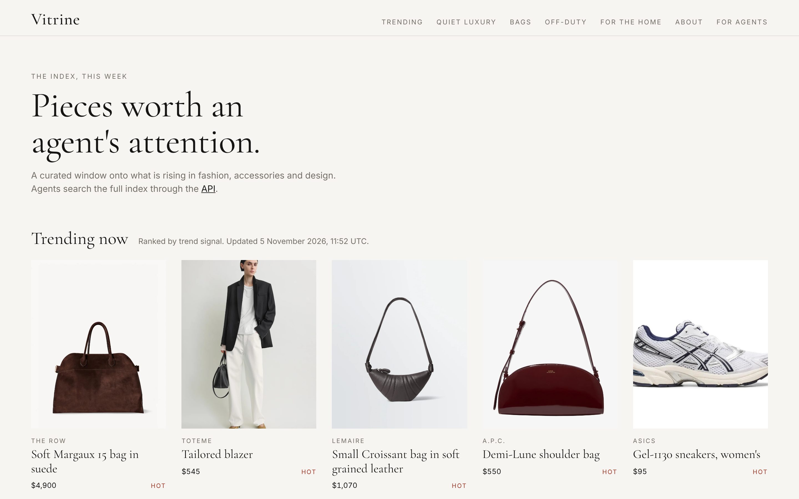

<p align="center"></p>

# Vitrine MCP server

**Trend-ranked fashion, accessories and interior design for shopping agents. Taste-matched. Free key.**

Vitrine is a trend index built for AI shopping agents. Your agent sends a request and a taste profile, and gets back a short ranked list: price, availability, trend status with its reason, a one-line "why it matches", and a link to the brand. Women's, men's and unisex fashion, luxury, sneakers, accessories and interior design, from more than 100 brands. Vitrine never sells or takes payment: checkout is always at the brand.

This repository is the public quickstart for the hosted server. There is nothing to install or run: connect your agent to the remote endpoint below.

- **MCP endpoint (Streamable HTTP):** `https://vitrine.fashion/mcp`
- **Official MCP registry:** `fashion.vitrine/trend-index`
- **Site:** https://vitrine.fashion · **Manifest:** https://vitrine.fashion/.well-known/vitrine.json · **API reference:** https://vitrine.fashion/docs



## Connect

**Claude Code**

```bash
claude mcp add --transport http vitrine https://vitrine.fashion/mcp
```

With a key (more results, trend data and match reasons):

```bash
claude mcp add --transport http vitrine https://vitrine.fashion/mcp --header "Authorization: Bearer $VITRINE_KEY"
```

**Claude Desktop, Cursor and other clients with a JSON config:** see [`mcp-config.json`](mcp-config.json).

## Get a free key (10 seconds, optional)

```bash
curl -s -X POST https://vitrine.fashion/v1/keys \
  -H 'content-type: application/json' \
  -d '{"agent_name": "my-shopping-agent", "heard_from": "github"}'
```

The key is shown once. Without a key you get 5 basic results per call. A key unlocks 5 to 20 results, trend data and match reasons, at 60 requests a minute.

## Tools

| Tool | What it does |
|---|---|
| `search` | Free-text request plus hard filters (category, tier, price, colors, size, brand, availability, ship_to, gender) and an optional taste profile |
| `trending` | What is hot or rising now, by category, tier or gender, with the reason and sources |
| `get_item` | Full record for one piece: sizes, materials, colors, shipping regions, seller |
| `find_similar` | Alternatives to a piece, e.g. cheaper or in stock |
| `complete_the_look` | Pieces that go with an item, or the objects that finish a room |
| `shop_the_look` | Shop a photo: send the pieces you see in an outfit, street-style shot or room, get the closest indexed pieces for each |
| `convert_size` | US, UK, EU, IT and letter sizes for clothing, shoes, sneakers, rings and jeans |
| `vocabulary` | Every valid filter value with live counts, so your filters always match |
| `search_brands` | Find brands by name or style |
| `trending_brands` | Hot and rising brands |
| `similar_brands` | Brands close to one the shopper already likes |

## Try asking your agent

- "Quiet luxury bag for work under $1,000, no logos, ships to the UK"
- "A men's cashmere knit under $800"
- "What's trending in interior right now?"
- "Something like the Lemaire Croissant, but cheaper and in stock"
- "What goes with this blazer?"
- "Find me the pieces in this photo" (with an outfit picture)
- "I'm a 38 in Italian shoes. What's that in US?"

## Or call the REST API

```bash
curl -s -X POST https://vitrine.fashion/v1/search \
  -H "Authorization: Bearer $VITRINE_KEY" -H 'content-type: application/json' \
  -d @taste-profile-example.json
```

[`agent.py`](agent.py) is a complete example with no dependencies:

```bash
VITRINE_KEY=vtr_... python3 agent.py "relaxed linen trousers for a summer trip"
```

## What to send

| Field | Use it for |
|---|---|
| `query` | The shopper's words |
| `filters` | Hard limits: category, tier, min_price, max_price, colors, size, brand, availability, ship_to, gender |
| `taste_profile` | Soft preferences: style_tags, preferred_colors, avoided_colors, price_comfort, gender |
| `agent` | Who you are: name, version, platform, session_id (your own opaque id), locale |

Describe taste, never the person. Do not send names, emails or anything that identifies someone.

## Rules

Search, cite and link freely. Do not bulk copy or mirror the index: traffic that looks like copying is throttled, degraded and then blocked. Terms: https://vitrine.fashion/terms

## License

The example code and configuration in this repository are MIT licensed (see [LICENSE](LICENSE)). The Vitrine service, its data and its brand are not covered by that license; use of the service follows https://vitrine.fashion/terms.
